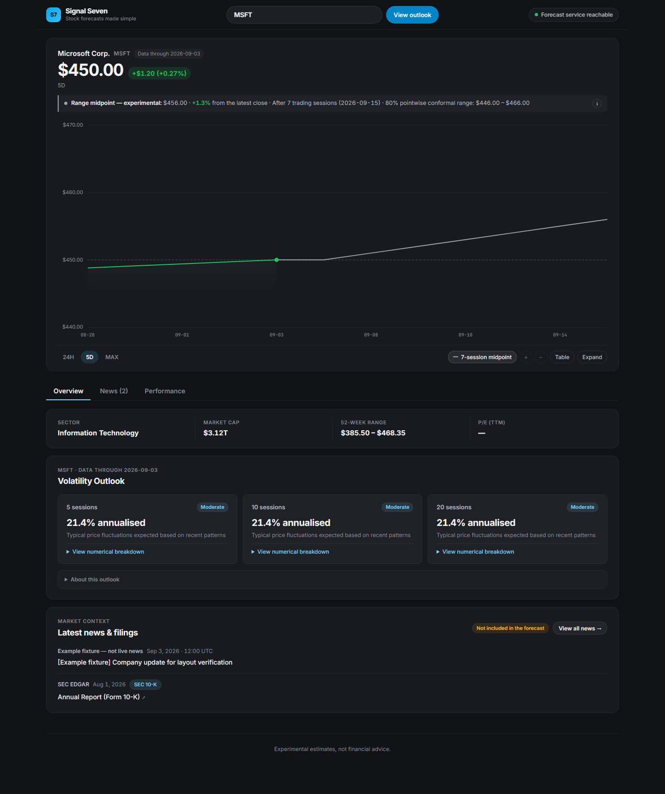

# Signal Seven

Explore a stock’s price history, a seven-trading-session price estimate and its volatility outlook. Search 286 NASDAQ, NYSE and London listings (195 US and 91 UK). Available history and forecasts vary by ticker.

**[Try the app](https://stock-predictor-lstm-two.vercel.app)** · [Run locally](#run-locally) · [API examples](#api-examples) · [Research and evidence](#research-and-evidence)



*MSFT example using deterministic fixture data.* The silver continuation plots the midpoint between each session’s lower and upper price bounds. Open **Table** for the exact values. Historical accuracy scores evaluate a separate series, the model’s point forecasts.

## Explore a stock

1. Enter **MSFT** and select a suggestion or choose **View outlook**. The landing page checks backend health. Selecting a ticker, or opening a [ticker deep link](https://stock-predictor-lstm-two.vercel.app/?ticker=MSFT&range=1M&tab=overview), loads its data. On a cold start, history can appear while the first forecast is still running.
2. Change the chart range, scrub a date for its price or estimate, or open **Expand**. In **Overview**, check the sector, market cap, 52-week range and available P/E. The 5-, 10- and 20-session volatility cards estimate the size of price fluctuations. Each horizon can succeed independently.
3. Open **News** to filter headlines and SEC filings. Only scored headlines contribute to the sentiment summary. Filing copies are grouped by accession. The price API can return a cached news summary alongside its forecast; the model uses price and volume history.
4. Open **Performance** for the available historical diagnostics and recorded volatility forecasts. Ledger entries identify which policy produced them. The frozen V1 ledger uses GARCH at one session and a rolling mean at longer horizons.

## What the forecasts measure

**Price.** The production `auto` configuration fits Ridge on completed daily sessions. Random Forest is an explicit alternative. The experimental LSTM requires a separate checkpoint and PyTorch. In a historical walk-forward evaluation on 30 tickers, Ridge’s mean absolute price error was 1.0171 times that of carrying forward the latest close. The chart midpoint has no separate accuracy score. [Price benchmark](reports/VALIDATION_M5_2026-11-23.md)

**Price uncertainty.** Eligible Ridge responses display **80% pointwise conformal range**. Across 20,839 historical forecast origins on that 30-ticker panel, 79.15% of individual session outcomes fell inside their bounds. All seven outcomes stayed inside their respective bounds for 50.45% of forecasts. The UI displays **Historical error range (experimental)** when the returned bounds lack the validated calibration. These historical rates do not guarantee coverage for a new forecast. [Calibration report](reports/VALIDATION_P1_CONFORMAL_2026-11-25.md)

**Volatility.** The default policy, `v5_duan_har`, serves GARCH(1,1) for the API’s one-session horizon and Duan-smeared HAR-RV for the three horizons shown in Overview. On the 30-ticker historical panel, HAR-RV reduced volatility forecast loss (QLIKE) relative to the 60-day rolling baseline by 9.0%, 12.5% and 19.3% at 5, 10 and 20 sessions respectively. Packaged G3 is available by explicit request and reports a rolling fallback if unavailable. G3 v2 remains a research model. [Volatility validation](reports/VALIDATION_P1_VOLATILITY_2026-11-25.md) · [Methodology](docs/methodology.md)

## Run locally

### Docker Compose

From the repository root with Docker Compose v2.24 or later installed, run:

```sh
docker compose up --build
```

Open [the local app](http://localhost:5500). The API listens on [port 8000](http://localhost:8000/docs). Stop the services with Ctrl+C, then run `docker compose down`.

### Native development

Use Python 3.11, uv and Node.js 22.22.2 or later in the 22.x series. Other supported Node versions are listed in the [frontend manifest](frontend/package.json). From the repository root, start the API in one terminal:

```sh
uv sync --project backend --python 3.11 --locked --no-install-project
uv run --project backend --no-sync python -m uvicorn api:app --app-dir backend --reload --port 8000
```

From the same root in a second terminal:

```sh
cd frontend
npm ci
npm run dev
```

Open [localhost:5500](http://localhost:5500). Vite proxies API requests to port 8000 by default. Local development uses Yahoo by default. To use Alpaca, configure `MARKET_DATA_PROVIDER`, `ALPACA_API_KEY_ID` and `ALPACA_API_SECRET_KEY` on the backend. For a separately hosted static frontend, set `VITE_API_URL` to the public backend URL before building.

## API examples

Open these read-only requests against a running local backend. The volatility batch returns successful horizons in `forecasts` and individual failures in `errors`.

| Request | What to inspect |
| --- | --- |
| [Health](http://localhost:8000/health) · [Readiness](http://localhost:8000/ready) · [Models](http://localhost:8000/models) | Service status, dependencies and configured model policies |
| [London daily history](http://localhost:8000/api/v1/history?ticker=SHEL.L) | Dated closes and quote units |
| [MSFT seven-session price estimate](http://localhost:8000/api/v1/forecast?ticker=MSFT&days=7) | Point predictions, bounds, calibration and cached news context. This route includes a `Server-Timing` header. |
| [MSFT volatility batch](http://localhost:8000/api/v1/volatility/forecast/batch?ticker=MSFT&horizons=5,10,20&model=auto) | Annualized volatility, model used and fallback evidence for each horizon |
| [MSFT news and filings](http://localhost:8000/api/v1/news?ticker=MSFT) | Headlines, filing links and publication times |

See the [API reference](docs/api.md) for additional routes, including company info, intraday history and the forward ledger.

## Research and evidence

The 286-stock catalog describes product coverage. Each validation study has its own historical population and evaluation period. The forward ledger records forecasts that can be scored after their target dates. This project is experimental and does not provide investment advice.

- [Price-signal experiments](artifacts/STUDY_SUMMARY.md) and [25-stock news replication](artifacts/news_replication25_v1/STUDY_SUMMARY.md) document the negative results behind the choice to show news as context.
- [G3 provenance](artifacts/PROVENANCE_FINAL.md) describes the packaged model’s historical validation panel.
- [Forecast cache design](docs/FORECAST_ARTIFACT_CACHE.md) explains reuse across requests and the limits of local storage on Render.
- The [contributor guide](AGENTS.md) and [CI workflow](.github/workflows/ci.yml) cover the full test setup, production bundle checks and browser contracts. [Screenshot reproduction](docs/verification/README.md) uses fixture data.

## License

[MIT](LICENSE)
